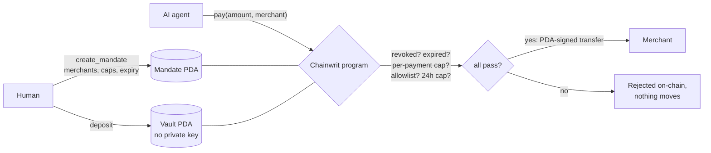

# Chainwrit

**Spending limits for AI agents, enforced by Solana.**

A human signs a mandate that names who an agent may pay, how much per payment, how much per day and until when. Funds sit in a vault owned by a program-derived address with no private key. The agent can only *request* a payment; the Solana program decides whether it happens.

> **The guarantee:** even if the agent is manipulated, its server compromised and its signing key stolen, funds cannot move outside the mandate.

- **Live demo:** https://chainwrit.vercel.app ([/demo](https://chainwrit.vercel.app/demo))
- **Program (devnet):** [`5BSoxqzNLqi7aZxLMRWCGXCm186aaUzswjHV7i99P9FW`](https://explorer.solana.com/address/5BSoxqzNLqi7aZxLMRWCGXCm186aaUzswjHV7i99P9FW?cluster=devnet)
- **Token:** `dUSDC`, our own devnet test mint ([`FqLbwG…LY6T5`](https://explorer.solana.com/address/FqLbwGWwNQ5PBYZhEbmfPMX9yw13easpRqtxh3CLY6T5?cluster=devnet)). It has no value.

---

## The problem

An agent that pays for things holds a private key, and whoever controls the key controls the money. Agents can be manipulated: hidden text in a web page reads exactly like an instruction from the user. On-chain payments are final.

| Defence | Where the rule lives | Why it fails |
| --- | --- | --- |
| "Don't overspend" in the prompt | Inside the model | Prompt injection attacks exactly this |
| Checks in your server code | On your server | A compromised server skips them |
| Provider wallet caps | In one vendor's platform | You trust the vendor, and you're locked in |
| **Chainwrit** | **On-chain** | Holds even when agent, server and key are all compromised |

## How it works



| Rule | Example | What it stops |
| --- | --- | --- |
| Merchant allowlist | Only these data APIs | Paying the attacker's address |
| Per-payment cap | At most 1 dUSDC per call | A single large theft |
| Rolling 24h cap | At most 5 dUSDC per day | A slow drain of many small payments |
| Expiry | Valid for 14 days | Stale, forgotten permissions |
| Revocation | Owner stops it instantly | An attack already in progress |

The allowlist is what stops the injection attack. A cap alone does not help: if the injection asks for less than the cap, the payment goes through. The attacker's address was never on the list, so the amount is irrelevant.

## Threat model

| Attacker has | So they control | What still holds |
| --- | --- | --- |
| A prompt injection in content the agent reads | The agent's decisions | Allowlist, caps, expiry |
| A compromised agent server | The agent's code and config | Allowlist, caps, expiry |
| The agent's private key | Valid signatures for `pay` | Allowlist, caps, expiry |
| A rogue agent operator | Everything off-chain | The owner can revoke and withdraw at any time |

Out of scope: a compromised **owner** key (it can withdraw by design), bugs in the program itself (it is unaudited), and merchants on the allowlist that misbehave.

## Proof on devnet

Seed run (`yarn seed`):

- Approved payment to merchant A: [41Tyw2…ohN3](https://explorer.solana.com/tx/41Tyw2Mw6gkrzRgwwgJDmLG3JRGjS6xQwz8tQ39vv6HpQWD6QXUUFg5tkcehedNqCW7wjzgfr8GFUvKQVVYrohN3?cluster=devnet)
- Rejected payment to the attacker, `MerchantNotAllowed`: [4A9wVr…MHGDy](https://explorer.solana.com/tx/4A9wVrCszbtkw76FVmjqa1HEPMyc5XuRmnLVbFCan1abjQ4RYVH3AfEV7WmRk3gwd1KmpaJxJcooxDEc59KMHGDy?cluster=devnet)

Stolen-key attack (`yarn attack`): no model involved, the attacker signs with the agent's real key.

| Attempt | Result |
| --- | --- |
| (a) Pay the attacker 1 dUSDC | Rejected, `MerchantNotAllowed`: [5BTKyt…gcurV](https://explorer.solana.com/tx/5BTKytcEek1hrjcAvW8eoYJb8c8wwQMzQ4xFqwobxb3zo5gZCqHRfMfUL5dw8yXCmQzu3on1o2iKUHzjFPWgcurV?cluster=devnet) |
| (b) Pay merchant A 10 dUSDC | Rejected, `ExceedsPerPaymentLimit`: [4DTefG…MaNDDB](https://explorer.solana.com/tx/4DTefGqRVVf7kRybkTZX1d6dL1CiqpkTxVbdDuiUpsdo9cWNW5YszqoVFutTHmVLJs82WYzXn8RGo5MZBcMaNDDB?cluster=devnet) |
| (c) Drain with 1 dUSDC payments | 4 paid to merchant A, then rejected, `ExceedsDailyLimit`: [2V71gf…eowzXqZ4](https://explorer.solana.com/tx/2V71gf1iXhHkGbQy83Dq1Aqh1ZaJk1PcfRp6aB8YdiTupK6LQi362Fux7U32eLEWCcCyxcyAKFJGvtP6eowzXqZ4?cluster=devnet) |

The attacker received nothing. All addresses are in [`deployments/`](deployments/).

## Repository

```
programs/chainwrit/   Anchor program
  src/lib.rs          instructions, accounts, events, errors
  src/rules.rs        the policy engine + 19 unit tests
tests/                integration tests on a local validator (17)
sdk/                  TypeScript client: PDAs, instructions, readable errors
mcp-server/           MCP server (stdio) exposing the mandate to any MCP client
web/                  Next.js landing page, live demo, x402-style merchant API
scripts/              devnet seed and the stolen-key attack
deployments/          public devnet addresses and proof transactions
```

The policy engine is pure: every rule lives in [`rules.rs`](programs/chainwrit/src/rules.rs) with no Solana account plumbing, so it can be read and unit-tested on its own. `pay` loads state, calls `rules::evaluate` and moves tokens only on `Ok`. A rejected payment leaves the mandate untouched.

Accounts:

- **Mandate PDA** `["mandate", owner, agent]`: the rules and spend counters. One owner can run many agents with different limits.
- **Vault PDA** `["vault", mandate]`: an SPL token account whose authority is the mandate PDA. No keypair exists for it, so funds only move through `pay` or `withdraw`.

## Quickstart

Requires Rust, Solana CLI 2.x, Anchor 0.32.1, Node 20+ and Yarn.

```bash
yarn install
cargo test -p chainwrit          # policy engine, 19 tests
anchor build && anchor test      # integration tests on a local validator
```

CI runs both on every push ([`.github/workflows/program.yml`](.github/workflows/program.yml)).

Devnet:

```bash
anchor deploy --provider.cluster devnet
export RPC_URL=https://api.devnet.solana.com   # or a Helius devnet URL
yarn build:sdk
yarn seed      # dUSDC mint, agent key, mandate, proof payments -> deployments/devnet.json
yarn attack    # the stolen-key attack against that mandate
```

Keypairs are written to `../keys` (override with `KEYS_DIR`), outside the repo.

## MCP server

Gives any MCP client (the demo uses Claude Desktop) a wallet it cannot misuse.

| Tool | What it does |
| --- | --- |
| `get_mandate` | Owner, allowlist, caps, spend in the last 24h, remaining, expiry, revoked, vault balance |
| `pay_merchant { merchant, amount, memo? }` | Sends `pay`. Returns the signature and Explorer link, or the decoded program error and a clear statement that the chain refused it |
| `fetch_page { url }` | Page text including hidden elements, the way a naive scraper sees it |
| `buy_data { url }` | x402-style purchase: GET, 402 with requirements, `pay_merchant`, retry with `X-PAYMENT: <signature>` |

```bash
yarn build:sdk && yarn build:mcp
```

`claude_desktop_config.json`:

```json
{
  "mcpServers": {
    "chainwrit": {
      "command": "node",
      "args": ["/abs/path/chainwrit/mcp-server/dist/index.js"],
      "env": {
        "RPC_URL": "https://api.devnet.solana.com",
        "AGENT_KEYPAIR_PATH": "/abs/path/keys/agent.json",
        "DEPLOYMENTS_PATH": "/abs/path/chainwrit/deployments/devnet.json"
      }
    }
  }
}
```

`MANDATE` can override the mandate from the deployments file.

## The x402-style flow

`/api/merchant/report` follows the HTTP 402 pattern. It is **not** a spec-compliant x402 facilitator.

1. `GET` without payment returns `402` and `{ amount, decimals, mint, recipient, program, mandate, reference }`.
2. The agent pays through its mandate.
3. The agent retries with `X-PAYMENT: <signature>`. The server fetches the transaction from devnet and checks that it is confirmed and succeeded, invoked the Chainwrit program with an accepted mandate, credited merchant A's token account with at least the price, is less than 10 minutes old, and has not been used before.

## Live demo

[`/demo`](https://chainwrit.vercel.app/demo) runs a scripted agent (no LLM) with a devnet key: it buys the report through the 402 flow, then reads [`/poisoned`](https://chainwrit.vercel.app/poisoned), an article with a hidden instruction to pay the attacker, and obeys it. The program rejects the payment on-chain, and the failed transaction is linked. Runs are rate-limited per visitor, and the mandate's own 24-hour cap bounds what the public demo can spend.

## Limitations

- Devnet only, with a test mint. The program has not been audited.
- Replay protection in the demo merchant is an in-memory set: it resets on cold start and is not shared between serverless instances.
- The demo rate limit is per instance and in memory.
- One owner key per mandate; no multisig yet.
- The allowlist holds up to 10 merchant wallets per mandate.

## Roadmap

- A spec-compliant x402 facilitator that settles through a mandate
- Linking mandates to AP2 intent and cart mandates
- An indexer for per-agent and per-task spend reporting from `PaymentExecuted` events
- Multisig and time-locked owners
- Per-merchant caps and categories

## Prior art

- [Solana Subscriptions & Allowances](https://docs.chainstack.com/docs/solana-agent-allowances-x402) gives an agent a capped, revocable on-chain budget; closest in trust model. Chainwrit adds merchant scope, per-payment caps and task attribution.
- **Coinbase Agentic Wallets** and **Crossmint** enforce caps inside their own platforms. Chainwrit is provider-neutral and enforced by the chain.
- Policy gates that check [AP2](https://ap2-protocol.org/) mandates in server code enforce off-chain, so a compromised server defeats them.

## License

Apache-2.0
